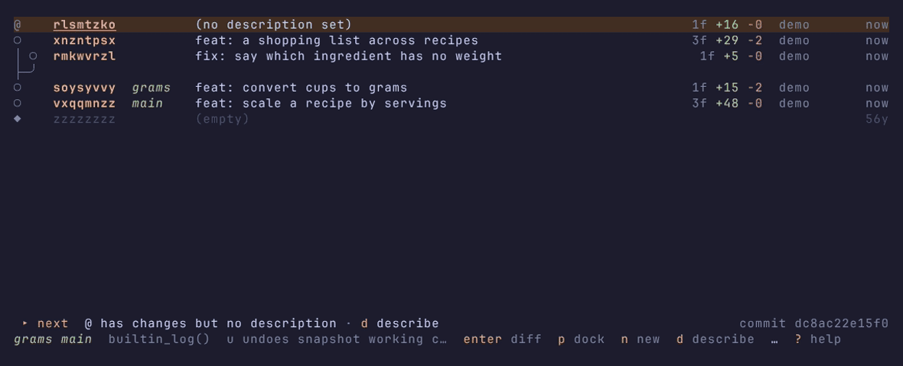
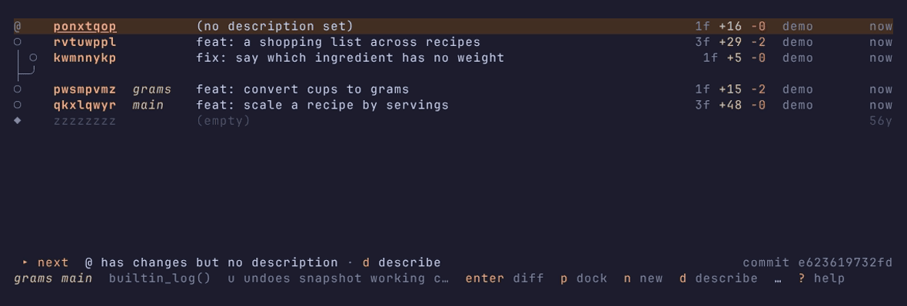
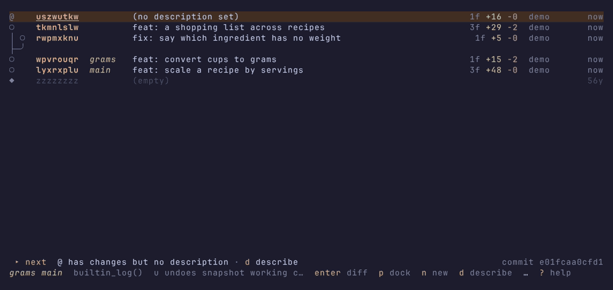

# jojo

A terminal UI for [Jujutsu](https://github.com/jj-vcs/jj), meant as a replacement for
lazygit rather than as another jj log browser.

Everything in [ROADMAP.md](ROADMAP.md) is shipped;
[docs/dogfooding.md](docs/dogfooding.md) is how to drive it.

```sh
mise run build
./jojo --repo path/to/repo
```

Each row says how big its revision is, and `p` docks the diff beside the log, following the cursor:



`s`, `r`, `y`, `N`, and `R` turn the log into a destination picker that previews the graph as it
will be after the command, and the footer is the live `jj` line:



`:` finds a verb by jj's word or git's (`amend` finds squash), and `?` explains a key:



The recordings run on an invented repository (`demo/scene.sh`); `mise run demo` makes them again.

The requirements and the survey of what exists were relocated from
[jj-diff](https://github.com/KyleKing/jj-diff) on 2026-09-02 once that project settled on
staying a diff tool.

## Why another one

[lazyjj](https://github.com/Cretezy/lazyjj) and [jjui](https://github.com/idursun/jjui)
both browse a jj repository, and neither reaches what lazygit does. The specific
complaints, which are the ones this project has to answer:

- The log is hard to read. A row spends its width on the author's full email address and
  a timestamp, when the change id, the bookmarks, and the description are what you scan
  for. Email and time are metadata, so they belong dimmed, abbreviated, or off the row
  entirely
- A row says nothing about size. How many files a revision touches and how many lines it
  adds and removes is what tells you whether to open it, and no existing tool puts that
  on the row
- Forge integration is missing or bolted on. Neither tool lists pull requests or CI state
  next to the revisions they belong to

### Alternatives

The wider field, for anyone who wants a jj front end today rather than waiting on this
one, plus the git TUIs and editors that set the bar:

| Service | Notes |
| --- | --- |
| [gg](https://github.com/gulbanana/gg) | "GG - Gui for JJ" |
| [gitui](https://github.com/gitui-org/gitui) | "Blazing 💥 fast terminal-ui for git written in rust 🦀" |
| [jayjay](https://github.com/hewigovens/jayjay) | "A native macOS GUI for Jujutsu (jj), DAG graph, side-by-side diffs, interdiff, conflict resolution. Built with Rust + SwiftUI" |
| [jj-fzf](https://github.com/tim-janik/jj-fzf) | "Text UI for Jujutsu based on fzf, centering around the jj log with key bindings for common operations" |
| [jj_tui](https://github.com/faldor20/jj_tui) | "A TUI for the Jujutsu version control system" |
| [jjui](https://github.com/idursun/jjui) | "jjui is a TUI designed for interacting with the Jujutsu version control system" |
| [Jujutsu Kaizen](https://github.com/keanemind/jjk) | "Jujutsu (jj) VCS support for VS Code" |
| [jujutsu.nvim](https://github.com/yannvanhalewyn/jujutsu.nvim) | "A Neovim frontend for Jujutsu with blazing fast UX" |
| [lazygit](https://github.com/jesseduffield/lazygit) | "simple terminal UI for git commands", the tool this project wants to replace |
| [lazyjj](https://github.com/Cretezy/lazyjj) | "TUI for Jujutsu/jj" |
| [lightjj](https://github.com/chronologos/lightjj) | "Lightning-fast JJ UI" |
| [madicen/jj-tui](https://github.com/madicen/jj-tui) | "A TUI for Jujutsu that incorporates some light PR and Ticket support" (name clash noted below) |
| [magit](https://github.com/magit/magit) | "It's Magit! A Git Porcelain inside Emacs" |
| [tig](https://github.com/jonas/tig) | "Text-mode interface for git" |
| [VisualJJ](https://www.visualjj.com) | "Jujutsu with your Git" (Closed source) |
| _[awesome-jj](https://github.com/Necior/awesome-jj)_ | "A curated list of awesome Jujutsu things" |

## What makes it different

The forge is detected from the git remote and the matching CLI is used behind an
interface (`gh` for GitHub first, `glab` and Forgejo later). This is not a `gh` extension
and does not install as one, which is where it parts company with
[gh-repo-dashboard](https://github.com/KyleKing/gh-repo-dashboard) and
[gh-sweep](https://github.com/KyleKing/gh-sweep). Those two are fleet tools that read
many repositories through GitHub. jojo reads one repository deeply and asks the forge
about it second.

Hunk-level and line-level diff work is not rebuilt here.
[jj-diff](https://github.com/KyleKing/jj-diff) already does it, so jojo runs it as jj's
diff editor the same way `jj split -i` does: when `jj-diff` is on PATH and jj's
`ui.diff-editor` is unset, the hunk verbs pass `--tool jj-diff`. Reading a diff happens inside
jojo, drawn by jj-diff's own `render` package, so a diff looks the same in both tools and
neither one has its own idea of what a diff looks like.

Shared plumbing comes from [aragonite](https://github.com/KyleKing/aragonite), which
already ships `vcs`, `forge/github`, `cache`, `transport`, `ratelimit`, and the `tui/`
packages for theming, overlays, tables, and key hints.

## Keys

`?` in the app is the authoritative list for the screen you are on, generated from the same table
the footer, the palette, and the handlers read. Pressing a key there explains it instead of running
it: what it does, the exact jj command shape, its flags, the keys beside it, and when you last used
it. `/` filters, `Enter` runs. A key that can do nothing where the cursor is stays in the footer
drawn flat, and pressing it says why (`x  kxqp has no conflict`) rather than doing nothing. That table is aragonite's shared `tui/keys`
vocabulary merged with jojo's jj verbs, so a key means the same thing here, in jj-diff, and in
second-look. A key that starts a sequence (`g`, `b`, `]`, `[`, `\`, `-`) waits with a panel of what
can follow it; `Esc` drops it. The ones worth knowing before you start:

| Key | Does |
| --- | --- |
| `j` / `k`, `gg` / `G`, `Ctrl+d` / `Ctrl+u` | move a revision (skipping graph connectors), top / bottom, half a page |
| `@` | jump to the working copy |
| `space` / `Esc` | check a revision, or clear the checks. While any are checked the footer counts them and `a` `n` `y` `r` `s` `P` run over all of them instead of the cursor; a write that goes through clears them. In the file list `space` checks files for `s`, `S`, and `c` (below). A check never writes |
| `/` | search the log, stepping matches with `Ctrl+n` and `Ctrl+p` |
| `:` | the command palette: search every action by its words, its jj command, or git's (`amend` finds squash, `stash` and `checkout` find new, `branch` finds bookmarks), and `Enter` runs it; `squash -i` opens squash's picker with `-i` on. After a run the footer names the key that would have done it. `:next` and `:tips off` are here too |
| `L` | edit the revset, which re-filters the log as you type; `Tab` completes, `Enter` returns to the log |
| `Tab` | cycle the log, the forge pane, and the docked diff |
| `Enter` / `=` | diff the revision, or diff it against another revision you pick |
| `p` | dock the diff beside the log, where it follows the cursor and keeps the file you were reading; `Tab` reaches it, and there `]h` / `[h` step hunks, `]f` / `[f` files, `n` / `N` repeat the last motion, `\s` switches to side by side |
| `Space` / `]u` / `[u` / `U` | read marks, in the dock and in the full-screen diff (`Enter`) alike: `Space` marks the hunk read (again: unread; on a file's heading, the file), `]u` / `[u` step to the next or previous unread hunk, `U` draws only what is unread. In the log and the outline `]u` / `[u` step revisions with unread hunks, whose rows end with the count (`◌3`), and `Space` in the outline marks the whole chapter. A mark follows the hunk's text, so it survives a rebase, and every workspace and jj-diff share it |
| `l` / `K` | the files the revision touches, or its details |
| `*` | a file's history, on a file in the file list or the file the cursor is in in the docked or full-screen diff (`git log --follow -- <path>`): the log narrows to the changes that touched it, back through every rename jj detects (it follows them name by name, since `jj log` has no `--follow`), and the dock follows the cursor showing that file alone. The scope is the ancestors of `@` and of the revision you pressed it on, plus whatever the log showed. `Esc` returns to the log, row and dock as they were |
| `n` / `N` | new on the revision (two or more checked: a merge), or new placed with the picker below |
| `e` / `E` | edit the revision, or edit its content in the diff editor (`jj diffedit`) |
| `d` / `D` | describe in a prompt that holds the whole description (`alt+enter` breaks a line, `alt+e` moves to `$EDITOR`), or straight in `$EDITOR` |
| `c` | commit `@`: describe it and start a new change (`jj commit`) |
| `s` / `r` / `y` / `R` | squash, rebase, duplicate, or restore, each in the picker below |
| `S` | split the revision into commits in jj-diff's columns (`jj-diff --split -r`), one column per commit |
| `a` / `A` | abandon (an empty change at once; one with changes names its files and waits for `y`, any other key keeps it), absorb |
| `x` / `X` | resolve the conflict in jj-diff's conflict viewer (`jj-diff --resolve -r`), or converge divergent changes (`jj converge`) |
| `I` | the stack outline: the revisions between `trunk()` and the cursor, plus what is stacked on it, as chapters parent first, each with its size, empty and conflict flags, bookmark, PR and CI state (asked of gh as it opens, and drawn compact as `#41 ○✓` when narrow), and a read strip with its unread count; the diff docks beside it, `]]` / `[[` step chapters, `]u` / `[u` chapters with unread hunks, `]h` the dock's hunks, `Enter` reads in the dock, `Space` marks the chapter read, `P` submits the stack as stacked pull requests (below), `Esc` returns to the log |
| `[r` / `]r` / `H` | rounds: step the docked diff through the change's `jj evolog` versions, each a true `jj interdiff` from the version before it; `H` lists the rounds to jump to one, and `R` there restores the change to it |
| `f` / `P` | fetch every remote, or push the revision's bookmarks, shown in a confirmation first |
| `F` / `gt` | sync: fetch every remote, then a report of what moved (bookmarks, changes that became immutable, conflicts that appeared, trunk itself); when trunk moved under a stack, `y` restacks every mutable stack onto it in one operation (`:sync-tracked` fetches only tracked bookmarks). `gt` jumps to `trunk()`, in the log or as a picker's destination |
| `bb` / `bc` | the bookmark list (set, advance, create, rename, delete, forget, track, push), or create one on the revision |
| `bs` / `ba` | move a bookmark to the revision in the picker, the graph previewed before `Enter` moves it (`-B` is `--allow-backwards`, which jj needs for a move backwards or sideways), or tug the bookmark on its nearest bookmarked ancestor up to it (`jj bookmark advance`), named from where to where and moved on `y`; a trunk bookmark is named as trunk's, and the coach never suggests moving it |
| `br` / `bd` / `bf` / `bt` / `bx` | rename, delete, or forget a bookmark on the revision (asking which when it has several), track or untrack its remote bookmark, or settle a conflicted one in the picker |
| `o` | the operation log, drawing the log as it stood at the operation under the cursor: `Enter` restores (after a confirmation), `u` reverts that operation, `p` shows its diff |
| `[o` / `]o` | step the log back or forward one operation, read-only: `Enter` restores to it, `o` opens the op log there, `Esc` comes back to now |
| `gh` / `gw` / `gm` | the forge pane, the workspaces, or every jj and gh command this session ran: the exact line, how it ended, `Enter` for all of its stderr, `Y` to copy it as a shell line, `u` to undo a write, `r` for the reads too |
| <code>&#124;</code> `B` | parallelize the checked revisions, bisect between two checked revisions; `jj arrange` is in the palette |
| `u` / `Ctrl+r` | undo the last operation, or redo it |
| `]x` / `[x`, `]b` / `[b`, `]]` / `[[` | step to the next or previous conflicted revision, bookmarked revision, or along the graph's edge (`]]` a child, up the screen; `[[` the first parent). `]b`, `]]`, `[[`, and `gt` also move a picker's destination |
| `.` | repeat the last write on the cursor with the same flags: a picker destination left on jj's default (the parent) follows the new revision, one you chose stays put. A description written with `d` repeats as the same message on the cursor (or the checked revisions), and `bd`, `bf`, and `bt` repeat on the bookmark the next revision carries; `bc` and `br` write a name typed for one place, so they do not |
| `'` / `Ctrl+o` / `Ctrl+i` | label jump: every revision on screen gets a letter (or two) in its gutter, and typing one lands the cursor there (in a picker, the destination); the jump list walks back and forward through where `gg`, `G`, `@`, `gt`, the `]`/`[` motions, and labels jumped from (`Tab` right after `Ctrl+o` walks forward too). The file list and the op log (`o`) answer the same three keys over their own rows, with `gg` and `G` as their jumps |
| `Y` / `!` | yank the change id, or open a shell in the repository root |

`S` and `x` hand the terminal to jj-diff v0.15.2 or newer, then read the log again and say in the
footer whether it wrote (judged by jj's operation log, so quitting without a pick says "nothing
written"). Without jj-diff on PATH, or with an older one, they run `jj split -i` and `jj resolve`
instead and the footer says why.

### The picker

`s` `r` `y` `N` `R` turn the log into a destination picker. `j` / `k` move the destination while the
graph redraws as it will be after the command, and the footer shows the live `jj …` line. Flags are
`-` then the letter jj itself uses, case and all, and a radio group swaps:

| Verb | Flags |
| --- | --- |
| rebase `r` | `-r` • / `-s` / `-b` what moves; `-o` • / `-A` / `-B` where; `-e` skip emptied, `-d` keep divergent, `-p` simplify parents |
| squash `s` | `-t` into • / `-o` / `-A` / `-B` (into a new commit placed there); `-u` keep the destination's message (on), `-m` write the message, `-k` keep emptied, `-i` choose hunks in the diff editor |
| duplicate `y` | `-o` / `-A` / `-B` once you move; `Enter` straight away duplicates in place, `Backspace` returns to it |
| new `N` | `-o` • / `-A` / `-B`, `-n` no-edit, `-m` write the message |
| bookmark `bs` / `bx` | `-B` allow backwards or sideways (`--allow-backwards`) |
| restore `R` | from the parent by default (which discards the revision's changes); `-i` choose hunks, `-d` keep descendants' content |

`-m` opens a one-line prompt where the command line stands: `Enter` keeps the message, `Esc` leaves
it as it was, and `-m` again drops it. `p` shows the graph before or after the command, `Enter` runs it as one operation, and `Esc` leaves
nothing behind.

The line over the footer is the inspector: whatever the row under the cursor had no room for at
this width (the whole description, bookmarks, author, age), with the commit id at its right edge.

Every action runs immediately and tells you to press `u`, because jj's operation log
makes all of them reversible. The footer keeps naming the operation `u` would reverse, so
the way back is never a guess. `u` and `Ctrl+r` are jj's own `jj undo` and `jj redo`, so
they step through the operation log the way an editor's undo stack does.

### Checking files, for people coming from git

The file list (`l`) has no index to stage into, because jj does not need one. `space` checks
files there, the same tick that checks revisions in the log, and like every tick it never writes.
The verbs then act on the checked files, or on the file under the cursor when none is checked:
`s` squashes them into a change you pick (`jj squash --from <rev> --into <dest> <paths>`), `S`
splits them out of the revision into a commit of their own (`jj split -r <rev> <paths>`), and in the
working copy `c` commits them (`jj commit <paths>`): they keep `@` and its description, and the
rest moves to a fresh change on top. That is `git add` and `git commit` in one step, and each is
one operation `u` takes back.

Two things ask first, because `jj undo` cannot take them back: a push, which has left the
machine, and an edit to a revision jj marks immutable. The second is not a wall. jj
refuses, jojo says why, and `y` runs the same edit again with `--ignore-immutable`.

### Stacked pull requests

`P` in the outline (or `submit-stack` from the palette) submits the stack as one pull request
per change, the jj way: each change gets a bookmark (its own, or the one `jj git push -c` would make, or
`stack_bookmark` from the config), each pull request is based on the bookmark below it, and the
bottom one on trunk. Nothing is written until you have read the plan: a row per change saying
whether its pull request is new, updated, retargeted, or already merged, the base it targets,
and then the exact jj and gh commands `Enter` runs. `-d` toggles drafts (on by default) and
`Esc` backs out. For a three-change stack with no pull requests yet, `Enter` runs:

```
jj bookmark create push-<a> -r <a>        # and for b, c
jj git push --bookmark push-<a> --bookmark push-<b> --bookmark push-<c>
gh pr create --head push-<a> --base main     --title '…' --body-file - --draft
gh pr create --head push-<b> --base push-<a> --title '…' --body-file - --draft
gh pr create --head push-<c> --base push-<b> --title '…' --body-file - --draft
gh pr edit push-<a> --body-file -           # and b, c: the stack section
```

Running it again is how a stack is kept current. An amend pushes and touches nothing on GitHub;
a reorder or a squash retargets each base, bottom up; an abandoned change's pull request is left
open and named in the plan, since deleting its branch would close everything based on it. Each
body carries a section between `<!-- jojo:stack -->` markers listing the stack top first, and only
that section is ever rewritten. A merged pull request at the bottom is left alone and the next one
is based on trunk; rebasing the rest onto trunk is your call, and the coach suggests it. A stack
with an empty, undescribed, immutable, conflicted, or divergent change is refused with the change
named. Every gh call lands in `gm` beside the jj ones, and the outline shows each chapter's pull
request, review, and CI once a plan has read them.

## What next

The line over the footer says the one next step the log suggests, and brightens its key in the
footer: a conflict under the cursor (`x`), an immutable revision (`n` starts a change on top
instead), `@` with changes and no description (`d`), a described `@` (`n` starts the next change),
a bookmark ahead of its remote (`P`). `coach_layout = "band"` in the config, or `:next` for the
session, lists every step that holds in a band over the footer with the jj command each runs.

Now and then, once you have been idle for a couple of seconds, the footer's left side offers a tip:
a key you have not used that would help (`◇ : finds any command by name`), or a shorter way to do
what you just did (`e` then `n` is `n` alone). Any key clears it. Tips are rare by design: none in
a session's first minute, ten minutes apart, four a session, and one you have taken or seen three
times never comes back. `:tips off` stops them. What has been shown and when each action last ran
live in `$XDG_STATE_HOME/jojo/coach.json`, which holds no keystrokes and feeds the palette's
recent list.

## Key usage

jojo logs the command keys you press, per context (`log`, `forge`, `help`, and one per overlay), and never the text you type into the revset box, a prompt, search, or the palette's query. A rebound key counts under its action, every command logs the action it ran, and a key the gate refused logs as refused, so `jojo keys` can tell what you reached for where it could not work. It records into `$JOJO_USAGE_DIR`, else `~/Sync/.jojo/usage/` when `~/Sync` exists, and records nothing when neither is there.

`jojo keys` reads the log back: the bindings never pressed, the ones gone stale for 30 days, keys pressed where nothing is bound, and keys that mean different things in different contexts. Keys you have not pressed lately draw bold or underlined in the footer and `?`.

Every run also logs the subcommand and the flag names it was given (`jojo keys -r`), never a flag's value, and `jojo keys` reports the subcommands and flags you have not used.

## Configuration

Everything is optional and jojo runs with no config file at all. It reads
`$XDG_CONFIG_HOME/jojo/config.toml`, or `~/.config/jojo/config.toml`:

```toml
# latte or light, macchiato or dark. Omit it to read the terminal's background.
theme = "macchiato"

# The diff editor split, diffedit, and squash -i hand the terminal to. Omitted or "auto"
# names jj-diff when it is on PATH and jj's own ui.diff-editor is unset; "none" leaves it to
# jj's config; any other name is passed as --tool.
diff_tool = "auto"

# The stack the outline (I) reads, {rev} standing for the revision under the cursor. Omitted, it
# is what that revision sits on above trunk() and what is stacked on it.
outline_revset = "(trunk()..{rev}) | ({rev}:: ~ ::trunk())"

# The bookmark a stack submit (P in the outline) gives a change that has none: {change} is its
# change id, {subject} its subject as a slug. Omitted, it is the name `jj git push -c` would give
# the change, from jj's templates.git_push_bookmark (push-<change id> unless you changed it).
stack_bookmark = "push-{change}"

# Where the next step and tips are drawn: "inline" (the line over the footer) or "band".
coach_layout = "inline"

# A file's type beside its name. Omitted or "auto", jojo draws Nerd Font icons in a terminal that
# bundles them (WezTerm, kitty, Ghostty, and tmux started from one) and plain unicode elsewhere;
# "nerd", "unicode" (or "plain"), and "none" (or "off") pick a set outright. ARAGONITE_ICONS
# overrides it, as in jj-diff and second-look. The last row under `?` names the set, why, and how
# to change it: icons  nerd (auto: WezTerm) · set icons = "plain" or ARAGONITE_ICONS=plain
icons = "auto"

# Move an action to another key by its action name (the palette shows them), as one key or a
# sequence; "" unbinds it. Shared actions keep aragonite's names, so hunk-next = "J" moves it in the
# dock as jj-diff and second-look would.
[keys]
describe = "M"
forge = "g p"
```

That is the whole file. Named revsets are jj's own `revset-aliases`, which the revset box
already completes, so jojo does not keep a second list of them.

A rebind moves a key rather than adding one, and jojo refuses to start on a setting it
cannot honor (an action it does not have, two actions on one key on one screen, a key that starts a
sequence such as `g`, a theme it does not know), because a preference that silently does nothing is
worse than one that says so. Action names from before the 0.15 keymap (`dock-diff`, `diff-range`,
`move-hunks`, `evolog`, `detail`, `last-failure`, `abandon-divergent`, and the rest) still rebind
the action that does that job now, and the footer says once which to rename.

The status line reports the jj command that ran (`jj rebase -r xyz --onto abc`) rather
than a description of it, and `:` lists every action beside the command it runs. Driving
the TUI should teach the CLI, not hide it.

## Docs

- [Requirements](docs/requirements.md) for what the tool has to do and why, including the
  jj paradigms the design has to respect
- [Comparison](docs/tui-comparison.md) for lazyjj, jjui, madicen/jj-tui, and jj-diff
  rated side by side, with screenshots
- [ROADMAP.md](ROADMAP.md) for the ordered work

## Name

Was jj-tui, until [madicen/jj-tui](https://github.com/madicen/jj-tui) turned out to be an
unrelated project with the same name. jojo replaced it: short, easy to type over an SSH
session, and close enough to the abbreviation to read as one. If you're wondering why it
fits so well: it was jj, all along.
